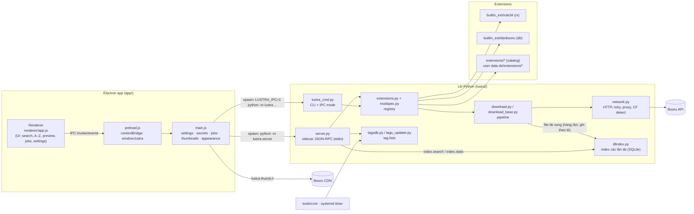

# Lustra — Components (kiến trúc & thành phần)

> Phiên bản tài liệu: 2.0 r1 · Cập nhật: 2026-11-16 · Liên quan: [specs](specs.md), [user stories](user-stories.md), [use cases](use-cases.md), [acceptance criteria](acceptance-criteria.md), [dev log](dev_log.md)

Lustra là bản phái sinh của **Ruxx** (trickerer01, MIT). Lõi tải xuống bằng Python được giữ lại và tái cấu trúc thành **registry extension**. Giao diện mới dùng **Electron**, nói chuyện với lõi qua **sidecar JSON-RPC**. Mỗi lượt tải chạy trong **một tiến trình CLI riêng**.

## 1. Sơ đồ tổng thể



## 2. Thành phần Python (`lustra/`)

| Thành phần | File | Trách nhiệm |
|---|---|---|
| Entry | `__main__.py`, `lustra.py` | Có tham số → CLI, không có → GUI Tk cũ (legacy) |
| CLI | `lustra_cmd.py`, `cmdargs.py` | Parse tham số (argparse), chọn module, chạy downloader. Khi `LUSTRA_IPC=1`: in dòng `@@LUSTRA_PROGRESS {json}` mỗi 0,4 s, nhận lệnh `cancel` qua stdin |
| Sidecar | `server.py` | JSON-RPC 2.0 trên stdio cho UI: tags, preview, count, extension, cập nhật tag, index các lần tải (`index.search`, `index.stats`; mỗi lời gọi một kết nối SQLite riêng). Chuyển toàn bộ `print` sang stderr để giữ kênh giao thức sạch |
| Registry module | `module.py` | `ProcModule`: id ổn định cho module mà lõi biết sẵn (rx=1 … bb=7, db=8); extension mới nhận id từ 100 trở lên (`register()`) |
| Registry extension | `extensions.py`, `modspec.py` | Đọc `manifest.json`, kiểm tra schema, import class downloader (`importlib`), đăng ký cú pháp tag, giới hạn tag, tiền tố file. Cài từ catalog, thư mục, zip (bắt buộc sha256, chống zip-slip) hoặc URL; gỡ cài đặt |
| Factory | `downloaders.py` | `DOWNLOADERS_BY_PROC_MODULE` do registry điền; `_make_downloader()` tự nạp catalog cho CLI/GUI cũ |
| Pipeline | `download.py`, `download_base.py` | Parse tag → chia task → đếm → tìm trang biên (binary search theo ngày/ID) → quét trang → chuỗi bộ lọc → tải → ghi info JSON. Truy vấn 1 task dùng **streaming**: quét theo thứ tự tải, lọc từng lô, tải ngay, `-dlimit` dừng quét sớm; Danbooru quét bằng cursor id. 3 executor bền (`scan`, `info`, `dl`) có hàng chờ giới hạn và huỷ tức thì. Hook và `CAPABILITIES` thay cho các kiểm tra tên module viết cứng |
| Index các lần tải | `dlindex.py` | SQLite `<data>/index/downloads.sqlite` (WAL, `busy_timeout` 10 s, schema theo `PRAGMA user_version`). Bảng `files` (một dòng mỗi file, khoá duy nhất là đường dẫn; index theo `(module, post_id)`, `md5`, ngày post, thời điểm tải), `tag_names` + `file_tags` (tìm tag chính xác hoặc theo tiền tố bằng index). `IndexWriter`: `Downloader._download` chỉ đẩy bản ghi vào hàng đợi, thread `dlindex` ghi theo lô; đóng (flush) ở cuối `_launch`, kể cả khi huỷ hoặc lỗi. `DownloadIndex.find_known` cho `-skip_known` (bộ lọc `_filter_known_items_by_id` trước khi lấy info, `_filter_known_items_by_md5` sau khi lấy info); `search` / `stats` cho sidecar. Chỉ metadata, không đọc file; tắt ghi bằng `LUSTRA_DLINDEX=0` |
| Mạng | `network.py` | `requests.Session` riêng cho mỗi thread (API và tải file, giữ keep-alive). Retry có giới hạn, `Retry-After` với backoff dùng chung cho mọi thread, dừng ngay khi gặp `cf-mitigated: challenge`, giãn cách request theo module. Tải file: 1 GET stream vào `.part`, không HEAD, resume bằng Range/If-Range, lỗi vĩnh viễn không retry; HTML/XML chỉ parse khi cần; tuỳ chọn tải không qua proxy |
| Cú pháp tag | `tags_parser.py`, `task.py`, `rex*.py` | Kiểm tra cú pháp; tách nhóm OR thành nhiều task; nhóm loại trừ `-(a,b)` thành regex; khi vượt giới hạn tag thì đẩy phần dư sang lọc cục bộ (cả tag phủ định lẫn tag dương, với module cho phép) |
| Tag DB | `tagsdb.py` | Nạp `<abbr>_tags.json` theo kiểu lazy vào cấu trúc gọn (khối bytes tên + mảng số), cache nhị phân ở `<data>/cache/tags/`, tối đa 2 danh sách trong RAM (LRU), lock riêng (thread-safe). Autocomplete xếp theo số post; duyệt A–Z (`browse`) bằng tìm nhị phân, kết quả sắp theo số post được cache |
| Cập nhật tag | `tags_updater.py`, `tools/update_tags.py` | Tải danh sách tag từ API: Rule34/Gelbooru dùng con trỏ `after_id`, Danbooru dùng `page=a<id>`, e621 dùng file export hằng ngày. Ghi file atomic, có kiểm tra sanity |
| Module tích hợp sẵn | `download_rx.py` (+`download_gelbooru.py`), `download_db.py` | Rule34 (DAPI XML) và Danbooru (JSON API) |
| Lớp nền JSON API | `download_json.py` | `DownloaderJsonApi` + `JsonPost`. Lớp con chỉ khai báo site, URL tìm kiếm, cách đọc một post, và (tuỳ chọn) cách đếm, URL con trỏ id. Lớp nền lo phần còn lại: đếm (từ trang, endpoint riêng hoặc tìm nhị phân trang cuối), chuỗi item cho lõi, URL tương đối, ngày ISO / unix, post không có file (bỏ qua, không dựng URL), quét theo con trỏ id khi vượt độ sâu trang. Template e621 / Moebooru / Philomena / Szurubooru và extension do AI viết dùng lớp này |
| Lọc giới tính (tầng 0) | `gender.py`, `gender_rules/{db,rx,en,gelbooru_generic}.json` | Suy nhãn `only_female/only_male/both/none/unknown` + độ tin cậy + cờ (futa, trap, other, anthro, pov, real) từ tag; `decide()` theo ngưỡng và chế độ strict. Bộ lọc `_filter_items_by_gender` chạy cuối chuỗi, không áp cho task parent |
| An toàn | `safety.py` | Danh sách chặn cứng (token + tag cụ thể). `_filter_items_safety` chỉ chạy khi bật bộ lọc giới tính, cho mọi task kể cả parent. Không có API gỡ; extension chỉ thêm |
| Tiện ích file | `file_tagger.py`, `file_sorter.py`, `file_searcher.py`, `file_parser.py` | Gỡ/gắn lại tag trên tên file, phân loại vào thư mục, tìm file trùng, đọc danh sách ID/info |
| Bộ tạo extension (công cụ) | `extgen/`: `fetch.py`, `engines.py`, `templates.py`, `policy.py`, `sandbox.py` + `sandbox_boot.py`, `scaffold.py`, `__main__.py` | `SafeFetcher`: chỉ https, IP công khai (chặn SSRF), đúng host của site, robots.txt (RFC 9309), 1 request/giây, ngân sách request, không cookie, redirect được kiểm lại, dừng khi gặp Cloudflare challenge (R5). Nhận diện engine bằng probe. Template cho 6 engine: `gelbooru_dapi`, `danbooru_json`, `e621_json`, `moebooru_json`, `philomena_json`, `szurubooru_json`. Kiểm tra tĩnh bằng AST (allowlist import, cấm eval / file / dunder / override hook lõi, sàn interval 0,5 s). Sandbox: tiến trình con `-I`, môi trường rỗng, rlimit, audit hook chặn socket / subprocess / ctypes / ghi ngoài tmp / đọc ngoài thư viện Python, mã Lustra, bản nháp và tmp; request của downloader đi qua tiến trình cha (`@@FETCH`, chỉ chuyển header `Accept`), file không được tải. Manifest: cấm cookie đăng nhập / challenge. Ghi fixture, chạy lại offline, đóng gói zip tất định + sha256. CLI cho skill |
| AI tạo extension | `aigen/`: `session.py`, `tools.py`, `prompts.py`, `template_agent.py`, `worker.py` | Vòng lặp Claude (stream, 9 tool phía client, lịch sử chỉ nối thêm) với giới hạn lượt / chi phí / số lần chạy thử, huỷ được. Sau khi model nói xong vẫn kiểm tra độc lập (`check_draft`). Chế độ `template` thay model bằng kế hoạch cố định, không cần khoá. Ghi `report.json`. Không có tool nào cài extension |
| GUI cũ (Tk) | `gui.py`, `gui_base.py`, `gui_defines.py` | Giữ để tương thích; tkinter giờ là tuỳ chọn với lõi (`utils.confirm_yes_no` import lazy) |

### 2.1. Hook và capability của downloader (mới)

| Hook / thuộc tính | Mặc định | Ghi đè bởi |
|---|---|---|
| `CAPABILITIES` (`ModuleCaps`) | sources, date_filter, comments | mỗi module (rx: api_key, api_key_required, parent_child…; db: api_key, parent_child, preview…) |
| `_parses_raw_pages()` | False | en, db (JSON) |
| `_supports_native_date_filter()` | False | db (dùng metatag `date:a..b`) |
| `_get_page_fetch_delay()` | 0 | rp, en, xb, bb: 1,0 s |
| `_get_page_scan_threads_divisor()` | 2 | rp: 4 |
| `_get_min_request_interval()` | 0 | en: 0,5 s; db: 0,25 s (dùng chung cho mọi thread) |
| `_use_chunked_download()` | True | rx: chỉ với video |
| `_fix_link_after_download_error()` | giữ link | rx: chuyển sang link gốc khi 404; rs: bỏ CDN |
| `_solve_module_specific_conflicts()` | — | en: giới hạn 2 thread khi lấy bình luận |
| `extract_preview_url()` | `preview_url` → `sample_url` → `` | — |

## 3. Extension

```
lustra/builtin_ext/rule34/manifest.json      entry: lustra.download_rx:DownloaderRx  (default)
lustra/builtin_ext/danbooru/manifest.json    entry: lustra.download_db:DownloaderDb  (default)
extensions/<id>/{manifest.json, downloader.py}   catalog cục bộ: rule34hentai, rule34us, paheal, e621, xbooru, bbooru
<data dir>/extensions/<id>/                  extension người dùng đã cài
```

- Thứ tự nạp: builtin → user → (catalog, chỉ cho CLI/GUI cũ hoặc khi gọi `_make_downloader` với module chưa nạp).
- Extension ngoài chỉ được dùng entry dạng file (`downloader.py:Class`). Entry dạng module Python chỉ dành cho builtin.
- Schema: [`schemas/extension-manifest.schema.json`](schemas/extension-manifest.schema.json).

## 4. Electron (`app/`)

| Thành phần | File | Trách nhiệm |
|---|---|---|
| Main | `main.js` | Vòng đời cửa sổ; dò Python (`settings.advanced.pythonPath` → `LUSTRA_PYTHON` → `.venv` → `python3`); quản lý sidecar (khởi động lại theo backoff, tối đa 5 lần); `Jobs` (hàng đợi, giới hạn số job song song, huỷ qua stdin, kill sau 15 s); settings JSON atomic; API key mã hoá bằng `safeStorage` (async); protocol `lustra-thumb://` (cache đĩa tối đa 512 MB, gửi Referer của site); proxy cho session thumbnail; đổi icon/nền; tạo launcher `.desktop`; chế độ tự kiểm thử `LUSTRA_SELFTEST_DIR`. `Generator`: chạy worker `aigen` (khoá Claude giải mã ở main rồi ghi vào stdin), chuyển event `gen:event`, liệt kê / đọc / xoá bản nháp (đường dẫn suy từ phiên + id, không lấy từ file), xuất zip, **cài chỉ khi người dùng bấm**: kiểm tra lại offline → đóng gói → hộp thoại xác nhận → `ext.install`. Khoá Claude lưu ở `secrets['@anthropic']` và chỉ ở dạng mã hoá |
| Preload | `preload.js` | Chỉ expose `window.lustra` (rpc, search, jobs, settings, secrets, gen, dialogs, appearance, app, on). `gen.setKey` chỉ ghi, không đọc lại. Renderer không thấy API key và không tự spawn tiến trình |
| Renderer | `renderer/index.html`, `styles.css`, `app.js` | Ô nhập tag dạng chip + autocomplete; gộp tag (OR, nhóm loại trừ, đảo, tách); ngăn và trang A–Z; Đếm; Preview (lưới, chọn post, lightbox thêm tag); tuỳ chọn tải (kể cả "Bỏ qua file đã tải" → `-skip_known`); hàng đợi tải (kèm số post bỏ qua vì đã tải); Tags A–Z (trạng thái danh sách và cập nhật); Extensions (kèm "Tạo extension cho site mới": form, tiến độ trực tiếp, chi phí, danh sách bản nháp, chi tiết kiểm tra, xuất .zip, cài có xác nhận); Settings (4 theme, icon, nền, số liệu index các lần tải qua `index.stats` và mặc định bỏ qua file đã tải, khoá Claude, model, chi phí tối đa); Nhật ký |
| Mock | `renderer/mock.js` | Giả lập `window.lustra` để chạy UI trong trình duyệt thường (thiết kế, kiểm thử) với thumbnail SVG trung tính |
| Assets | `assets/icons/*.png` | 4 icon (512 px + 64 px) lấy từ bộ Lustra_8_Icons_1024 |

### 4.1. Icon & hình nền
- **Nền mặc định** là toàn bộ icon đang chọn, đặt giữa vùng nội dung và làm mờ (mặc định blur 4 px: hơi mờ nhưng vẫn rõ nét viền; độ hiện 90%, lớp phủ tối 18%). Nền nằm sau mọi panel; panel kính chỉ blur 3 px nên vẫn thấy rõ viền icon qua chúng. Thanh trượt độ mờ có dải 0–40 px.
- **Nền tuỳ chọn** là ảnh do người dùng chọn, được copy vào `<userData>/backgrounds/` và **không làm mờ**.
- **Đổi icon** có hiệu lực ngay trong app: logo, nền, `BrowserWindow.setIcon` (Windows/X11), `app.dock.setIcon` (macOS). Riêng trên **Wayland**, compositor lấy icon từ desktop entry, nên icon trên taskbar chỉ đổi sau khi mở lại app. Đây là lý do trước đây "phải relaunch mới load được". UI báo rõ điều này, có nút **Cập nhật launcher** (ghi `~/.local/share/applications/lustra.desktop` trỏ tới icon mới) và nút **Khởi động lại**.

## 5. Công cụ & vận hành

| Thành phần | Đường dẫn |
|---|---|
| Cập nhật tag (CLI) | `tools/update_tags.py` |
| Đo độ phủ nhãn giới tính | `tools/gender_coverage.py` (chỉ đọc tag, không tải ảnh) → `docs/reports/gender-coverage-*.json` |
| Cronjob | `tools/cron/lustra-update-tags.sh`, `tools/cron/crontab.example` |
| systemd user timer | `tools/systemd/lustra-update-tags.{service,timer}` |
| Test | `lustra/tests/tests.py` (gốc Ruxx), `lustra/tests/test_lustra.py`, `lustra/tests/test_gender.py` (mới) |
| Build exe | `python lustra/release` (PyInstaller, kèm manifest builtin) |
| Lõi đóng băng cho app | `tools/build_core.py` + `lustra/frozen_main.py` (`lustra-core server` / `cli …` / `aigen` / `extgen …` / `sandbox`), electron-builder trong `app/package.json`. Mã tham khảo cho model được kèm ở `aigen_refs/`; `anthropic` được kèm nếu có trong môi trường build |
| Skill Claude Code | `.claude/skills/new-site-extension/` (`SKILL.md`, `reference/`): từ link site tạo bản nháp bằng `python -m lustra.extgen`, vào `.extgen-drafts/` (git bỏ qua), không cài |
| Test index các lần tải | `lustra/tests/test_dlindex.py`: schema/WAL, upsert, tìm theo tag/module/ngày, writer theo lô không chặn khi CSDL bị khoá, 4 tiến trình ghi đồng thời, pipeline giả (streaming và cổ điển) ghi index, `-skip_known` theo id / md5 khác module / file đã xoá, RPC và wiring app. `lustra/tests/__init__.py` đặt `LUSTRA_DLINDEX=0` cho mọi test khác (không ghi vào index thật) |
| Test bộ tạo extension | `lustra/tests/test_extgen.py`: site giả qua `SafeFetcher` thật, model giả theo kịch bản, SDK `anthropic` thật nối vào server SSE cục bộ, giao thức worker |
